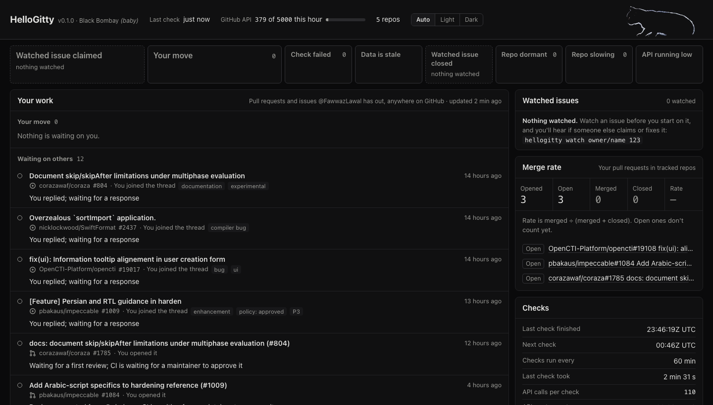

# Reading HelloGitty

A guide to every part of the dashboard and what to do with it. For installing and configuring,
see the [README](../README.md).

HelloGitty is built to be left open all day and glanced at. It answers two questions without you
opening a single GitHub tab: **what is waiting on me?** and **how are the projects I care about
doing?** Most of the page stays calm on purpose. Colour appears only when something needs you, so
the first rule of reading it is simple: **if nothing is lit, nothing needs you.**



---

## The five-second check

1. Look at the row of cells under the header.
2. Is **Your move** lit? Read the **Your move** list at the top of the page.
3. Is anything else lit? Read its name, then the names written inside it.
4. Nothing lit? You're done.

Red means stop and look now. Amber means it's your turn, or worth knowing today. Green means good
news. Nothing else on the page uses those colours.

---

## Layout

```
┌──────────────────────────────────────────────────────────────────────────────┐
│ HelloGitty  version  Last check · GitHub API · repos   [Auto|Light|Dark] [cat]│  header
├──────────────────────────────────────────────────────────────────────────────┤
│ [Watched issue claimed] [Your move] [Check failed] [Data is stale] ...        │  alerts
├──────────────────────────────────────────────────────────────────────────────┤
│ [Search…] [All|PRs|Issues] [Org / repo ▾] [ ] Needs me only  Group by [...]  │  toolbar
├──────────────────────────────────────────────┬───────────────────────────────┤
│ Your work                                     │ Watched issues                │
│   Your move · Waiting on others · Finished    │ Merge rate                    │
│ Your repositories                             │ Checks                        │
│   Needs you · Waiting on contributors         │                               │
│ Tracked repositories                          │                               │
└──────────────────────────────────────────────┴───────────────────────────────┘
```

On a phone the same parts stack in one column.

---

## Header

| Item | Meaning |
|---|---|
| **HelloGitty** and version | The build you are running, e.g. `v0.1.0 · Black Bombay (baby)`. `dev build` means an untagged build. Quote it when reporting a bug. |
| **Last check** | How long ago HelloGitty last finished checking your tracked repositories, in words. Hover for the exact UTC time. |
| **GitHub API** | Calls used against your hourly GitHub budget, with a small gauge that turns amber at 90%. |
| **Repos** | How many repositories are tracked (and, with a pipeline command, how many it reports a stage for). |
| **Auto / Light / Dark** | The colour theme. Auto follows your system setting; Light or Dark overrides it and is remembered in this browser. |

The kitten at the right end is the mascot (see [The mascot](#the-mascot)). It carries no data.

---

## Alerts

One cell per condition. Each cell has three looks:

- **Dark with a label:** the condition is not true. This is the normal state.
- **Dashed border:** there is nothing to check yet (for example "nothing watched"). This is not
  an all-clear.
- **Solid colour:** the condition is true. The count is on the right, and what's involved is named
  underneath. If more are involved than fit, it shows `+N`; hover the cell for the full list.

| Cell | Colour when lit | Lights when | What to do |
|---|---|---|---|
| **Watched issue claimed** | red | An issue you are watching was assigned to someone, or someone commented in the last 30 days that they are taking it. | Don't start work on it. Pick something else or talk to that person. |
| **Your move** | amber | Anything in **Your move** or **Needs you** (below). Names the items. | Work through the Your move list. |
| **Check failed** | red | A tracked repository, the pull request search, or the Your work refresh failed. | Open the repository's row, or read the error in the panel. See [Troubleshooting](#troubleshooting). |
| **Data is stale** | red | The last successful check of your repositories finished more than two hours ago. | HelloGitty has probably stopped. Restart it. |
| **Watched issue closed** | amber | A watched issue was closed, fixed or not. | Read how it was closed, then unwatch it. |
| **Repo dormant** | amber | A tracked repository has had no commit for more than 90 days. | Work sent there may never be reviewed. |
| **Repo slowing** | amber | No commit for more than 30 days. | Expect slower reviews. |
| **API running low** | amber | Less than 10% of the hourly GitHub budget is left. | Wait for the reset (see Checks). |

With a pipeline command configured, two more cells appear, named by your command: one for
repositories it marks as needing attention, one for a stage it reports as failed.

---

## Filtering and organizing

The toolbar under the alerts narrows and rearranges the lists. It never touches the alert cells:
an alarm always counts everything, whatever you have filtered.

| Control | What it does |
|---|---|
| **Search** | Matches titles, repositories, numbers (`#123`), labels, status text and people (`@name`). Several words must all match. Press `/` anywhere to jump to it and `Esc` to clear it. |
| **All / PRs / Issues** | Shows only pull requests or only issues in Your work and Your repositories. |
| **Organization or repo** | Narrows every list, including Tracked repositories and Watched issues, to one owner or one repository. The menu lists only owners and repositories on the page. |
| **Needs me only** | Hides everything that isn't your move. |
| **Group by** | *Whose move* is the normal view. *Repository* and *Organization* regroup Your work and Your repositories under each repository or owner, with groups holding something that's your move listed first. Each row then shows a small tag saying whose move it is. |
| **Sort** (Tracked repositories) | Furthest stage first (or name), name, most open issues, most good first issues, most unassigned, most recent commit, or most turned down. |

While a filter is on, list headings read "2 of 15", the toolbar says how many items are showing,
and **Clear filters** appears. A filter that matches something in the folded Finished list opens
it. Your choices are remembered in this browser, so the 5-minute reload keeps them.

---

## Your work

Every pull request and issue your GitHub account has out, **anywhere on GitHub**, not only in
tracked repositories. It refreshes every 5 minutes. Items fall into three groups:

- **Your move:** the next step is yours. Longest waiting first.
- **Waiting on others:** you've done your part; a reviewer, maintainer or reporter hasn't
  answered yet. Longest waiting first.
- **Finished in the last 30 days:** merged or closed. Click the heading to open or fold it; the
  page remembers.

### Reading a row

```
●  Add retry to the uploader
   ⎇ owner/repo #123 · You opened it
   Changes requested by @alice   [Merge conflict]                    2 days ago
   ┌──────────────────────────────────────────────────────┐
   │ @alice Could you add a test for the timeout path?   │
   └──────────────────────────────────────────────────────┘
```

- **Dot:** amber means it's your move; green means good news (approved, merged); a hollow ring
  means it's neutral.
- **Only you:** a solid amber tag in front of the status when the next step can't be done by
  anyone else with the branch: signing a CLA, signing off commits for a DCO check, or answering a
  human reviewer in your own words. These rows sort to the top of Your move.
- **Title:** opens the pull request or issue on GitHub.
- **Second line:** a pull request or issue icon, the repository and number, why it's on your
  board (you opened it, it's assigned to you, or you joined the thread), and the item's labels.
  Labels often say what a project expects next (`cla: pending`, `needs-triage`).
- **Status:** one sentence saying what happened last and whose turn it is.
- **Chips:** extra facts worth a glance. Amber: *Failing:* and the check names, *Merge conflict*,
  *Behind main* (the branch needs updating), *N unresolved threads*. Neutral: *Waiting on:* and the
  checks still pending, *CI awaiting maintainer approval*. Green: *Checks passed*, shown only when
  every check ran and passed.
- **Quote:** the comment worth reading before you act: the unresolved review comment the status
  is about, or else the latest word from someone else. Formatting, code blocks and quoted replies
  are stripped.
- **Time:** how long the item has been in its current state. Hover for the exact time.

### What each status means

**Your pull requests**

| Status | Whose move | Meaning |
|---|---|---|
| Sign the CLA (check: description) | yours, only you | A CLA check is pending or failing, or a label says the CLA is missing. |
| Sign off your commits for the DCO check | yours, only you | The DCO check isn't passing. |
| @name is waiting for your reply on a review comment | yours, only you | A person left a review comment that is unresolved and you haven't answered. |
| Changes requested by @name | yours | A reviewer asked for changes and you haven't pushed since. |
| N unresolved review comments from @name; merging is blocked… | yours | Review threads (often from review bots) are open and unanswered. GitHub can block the merge on them even when every check is green and no one has requested changes. |
| @name commented / left a review | yours | Someone spoke after your last push or comment. |
| Failing: check names | yours | Those checks failed on your latest commit. |
| Merge conflict to resolve | yours | The branch no longer merges cleanly. |
| Branch is behind main; update it | yours | The base branch moved on and the project requires branches to be up to date before merging. |
| Labelled "waiting on author": the maintainers are waiting on you | yours | A label says the project is waiting for you. |
| Draft: mark it ready… | yours | It's still a draft. |
| You pushed changes; waiting for @name to look again | theirs | You answered a change request with new commits. |
| Approved by @name; waiting to be merged | theirs | Approved; a maintainer needs to merge it. |
| Review requested from @name | theirs | A reviewer is assigned and hasn't reviewed yet. |
| You replied; waiting for a response | theirs | You spoke last. |
| Waiting for a first review | theirs | Nobody has looked yet. |
| …; CI is waiting for a maintainer to approve it | theirs | Many projects don't run CI for a first-time contributor until a maintainer approves it. Nothing is broken; it just hasn't run. |
| Merged by @name / Closed without merging | finished | The quote shows the last thing a maintainer said. |

A push after someone's comment counts as your answer, so the item moves to Waiting on others.
A review thread you replied to last counts as answered; resolving it is the reviewer's job.
Threads, check names and labels are fetched for your own open pull requests; other rows use the
combined check state.

**Your issues** (opened, assigned, or a thread you joined)

| Status | Whose move |
|---|---|
| Labelled "needs info" (or similar): the maintainers are waiting on you | yours (issues you opened) |
| @name replied / commented after you | yours |
| Assigned to you | yours |
| No replies yet | theirs |
| You replied; waiting for a response | theirs |
| Closed as completed / not planned / a duplicate | finished |

---

## Your repositories

Open pull requests and issues **from other people** in repositories your account owns, plus any
you list under `"maintain"` in `hellogitty.json` (a repository like `"org/name"` or a whole
organisation like `"org"`). Pull requests where your review was requested appear here too, from any
repository.

- **Needs you:** a review was requested from you; a pull request was updated since your review;
  a new pull request nobody has reviewed; an approved pull request ready to merge; a new issue
  nobody has answered; someone commented after you.
- **Waiting on contributors:** you spoke last, or the pull request is a draft.

---

## Tracked repositories

The repositories you follow, from your config, with their health. Rows your pipeline command
reports come first, furthest stage first; the rest follow alphabetically.

| Column | Meaning |
|---|---|
| **Light** | Green dot: active, a commit in the last 30 days. Amber ring: slowing, 31 to 90 days. Amber dot: dormant, over 90 days. Dashed ring: not checked successfully yet. |
| **Repository** | Owner (dim) and name. |
| **Stage strip** and **status** | Only with a pipeline command: one square per stage (grey done, white current, amber failed; dotted when the command doesn't report the repository) and the command's label. |
| **Open** | Open issues, pull requests not counted. |
| **Good first** | Open issues labelled good first issue (`good first issue`, `good-first-issue` or `good_first_issue`). |
| **Unassigned** | Open issues nobody is assigned to. |
| **Last commit** | Days since the last commit, with a bar that fills over 120 days and turns amber after 30. |
| **Watching** | How many of this repository's issues you watch. |
| **Turned down** | Pull requests from outside contributors, among the latest 100 closed, that were closed without merging. Bots and pull requests the maintainer says they merged by hand are not counted. |

Click a row to open it (it stays open across reloads): a link to the repository, its watched
issues, your pull requests there, and the last five turned-down pull requests from outside
contributors, each with who sent it (first-time or past contributor), the review verdict, when it
was closed and the maintainer's last comment. Read those comments before contributing to a new
project: they say, in the maintainers' own words, what they turn down and why.

---

## Watched issues

Issues you plan to work on, across all tracked repositories, most urgent first.

| Status | Meaning |
|---|---|
| **Claimed** (red) | Assigned to someone, or a comment in the last 30 days such as "I'll take this", "I'm working on this", "taking this" or "I can do this". The link goes to the claim. |
| **Fixed** (amber) | Closed by a merged pull request or a commit. |
| **Closed** (amber) | Closed without a linked fix. |
| **Open** (green) | Open and unclaimed. |

```bash
hellogitty watch owner/name 123          # watch issue 123 (several numbers allowed)
hellogitty watch                         # list what you are watching
hellogitty unwatch owner/name 123        # stop watching issue 123
```

To watch, the repository must be one you track; the new watch shows up after the next check.
An unwatched issue leaves the page on its next reload.

---

## Merge rate

Counts of pull requests your account opened **in tracked repositories**: opened, open, merged,
closed (without merging) and rate, which is merged ÷ (merged + closed). Open ones don't count
toward the rate. With a pipeline command this panel is titled **Pipeline** and also shows how many
repositories sit at each stage.

---

## Checks

When the last check of your tracked repositories finished and when the next one starts, how often
they run (60 minutes by default), how long the last one took, how many API calls it used, when
the hourly GitHub budget refills, what the last Your work refresh cost, and a link to
`snapshot.json`, the same repository data in machine-readable form. Your work refreshes separately,
every 5 minutes, using GitHub's GraphQL API, which has its own 5,000-point hourly budget and
doesn't count against the number in the header. A refresh usually costs around 30 points.

---

## Changes since your last look

The page reloads itself every five minutes. A number or status that changed since the previous
reload is underlined and blinks twice, so after time away you can see what moved. With reduced
motion turned on in your system settings, it is underlined without blinking.

---

## The mascot

The kitten at the top right is Black Bombay (baby), the mascot of the current release line. It
plays one short, silent clip each time the page reloads, a livelier one when something changed,
and otherwise rests. It never loops, carries no data, and is hidden from screen readers. With
reduced motion turned on, you see a still image. In the light theme it sits in a small dark window.

---

## Everyday use

**Glance.** If **Your move** is lit, work down that list from the top: it's sorted by who has
waited longest. Each row's quote usually tells you what to do without opening GitHub.

**Maintaining.** Check **Your repositories → Needs you** for reviews and unanswered issues.

**Choosing new work.** In **Tracked repositories**, look for a green light, a healthy Good first
count and many unassigned issues. Open the row and read what gets turned down first.

**Before you start an issue.** Watch it. If someone else claims it while you work, the red cell
lights.

---

## Troubleshooting

| You see | Likely cause | Fix |
|---|---|---|
| **Data is stale** lit, Last check getting older | HelloGitty stopped, or the computer slept. | Restart it. |
| **Check failed** naming one repository, error `404` | The repository was renamed, moved or made private. | Update its entry in your config. |
| **Check failed** naming everything, error `401` | The GitHub token expired or was revoked. | Set a new `GITHUB_TOKEN` and restart. |
| **Check failed** naming "your work" | The Your work refresh failed; the panel shows the error and keeps the previous list. | Usually clears on the next refresh. If it says the token lacks access, use a token that can read your repositories. |
| Your work says it hasn't been fetched yet | HelloGitty just started. | Wait a few seconds; the page reloads on its own. |
| Error mentioning a rate limit | GitHub's hourly or burst limit was hit. | HelloGitty waits and retries. |
| A very large repository shows Check failed saying exact totals are unavailable | Its issue list is too long to fetch page by page and the search for exact totals failed. | It retries on the next check; rather than show a partial number, the repository is marked failed. |
| **GitHub API** near the limit every hour | Many large repositories, or a short interval. | Track fewer repositories or set `"interval"` longer. |
| Merge rate says "Not counted yet" | The pull request search runs after the first check finishes. | Wait for the first check. |
| The page won't load | HelloGitty isn't running, or is on another address. | Start it; the address is the `listen` setting (default `localhost:7340`). |
